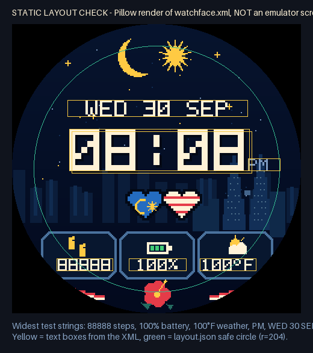

# Malaysia Pixel · Lite — Wear OS watch face (Watch Face Format)

A round, digital, pixel-art Wear OS watch face built from the **Malaysia Pixel Lite V1**
asset pack (`design/asset-pack/`). It uses Google's **Watch Face Format (WFF) version 1**:
a resource-only package (no code) that the Wear OS system renders. It needs Wear OS 4
(API 33) or newer.

Test status and evidence: see [`docs/TEST_REPORT.md`](docs/TEST_REPORT.md).



*Above: a Pillow render of `watchface.xml` with the widest test strings. It is a layout
check, not an emulator screenshot. Real emulator screenshots are in `docs/emulator-run/`.*

## What the watch face does

| Area | Source of the value | Notes |
|---|---|---|
| Time `HH:MM` | `DigitalClock`/`TimeText`, `hourFormat="SYNC_TO_DEVICE"` | Follows the watch's 12/24-hour setting. |
| AM/PM | `[AMPM_STRING]`, shown only when `[IS_24_HOUR_MODE]` is false | Hidden in 24-hour mode. |
| Date `WED 14 OCT` | `[DAY_OF_WEEK_S] [DAY] [MONTH_S]`, upper-cased | Localised by the watch (for example Malay `RAB 14 OKT`). |
| Steps (left frame) | `[STEP_COUNT]` system data source | Whatever the watch reports; no value is hard-coded. |
| Battery (middle frame) | `[BATTERY_PERCENT]` | The watch battery. |
| Weather (right frame) | User-selected **complication** (`SHORT_TEXT`) | Empty by default. Choose a weather provider in the watch face editor. While it is empty, nothing is drawn. |
| Always-on (AOD) | `12_aod_bg.png` + time (+ AM/PM in 12-hour mode) | Static, no animation, no date or data. |

**Weather icon.** Only one icon is ever drawn. If the provider sends its own monochrome
icon, that icon is shown (tinted cream). Otherwise the pack's `09_icon_weather.png` is shown
at its original position.

**Editor options** (long-press the face → *Customise*/*Edit*):

- Star speckles, KL skyline, and flag arcs. These are the pack's optional layers, on by
  default. Turn them off for a plainer face.
- Navy always-on background: on by default, as the brief asked. See the AOD note below.
- Always-on moon & star (`13_aod_moon_star_optional.png`): off by default.
- Weather slot: any provider that supplies `SHORT_TEXT`.

Labels are provided in English and Bahasa Melayu (`values-ms`).

## Project layout

```
wearos/malaysia-pixel-lite/
├─ design/asset-pack/          original asset pack (source of truth; not packaged as-is)
├─ watchface/src/main/
│  ├─ AndroidManifest.xml      hasCode=false, WFF version 1, no permissions
│  └─ res/
│     ├─ raw/watchface.xml     the watch face definition
│     ├─ drawable-nodpi/       mpl_*.png = byte-identical copies of the pack layers
│     ├─ font/malaysia_pixel.ttf   generated from the pack's 5x7 GLYPHS table
│     ├─ xml/watch_face_info.xml
│     └─ values*/strings.xml
├─ tools/build_resources.py    regenerates drawables, font and preview from design/
├─ tools/check_watchface.py    static checks + labelled evidence images
├─ tools/validate_wff.sh       builds Google's official WFF validator and runs it
├─ scripts/emulator-test.ps1   Windows: build, install, screenshots, report
└─ docs/                       test report, evidence images, emulator runs
```

## Build and run on Windows

### What to install (once)

1. **Android Studio**, current stable version. It includes a JDK (JBR 21). The project
   uses Android Gradle Plugin 9.0.0 and Gradle 9.2.1, the same as Google's official WFF
   samples. The Gradle wrapper downloads Gradle itself.
2. In Android Studio, open **Tools → SDK Manager**:
   - *SDK Platforms*: **Android 16 (API 36)** (to compile).
   - *SDK Tools*: **Android SDK Build-Tools**, **Android Emulator**, and
     **Android SDK Platform-Tools**.
3. **Device Manager → Create Virtual Device → Wear OS → Wear OS Large Round**. Pick a
   **Wear OS 5 (API 34)** or newer x86_64 system image. For a small-screen check, also
   create **Wear OS Small Round**. API 33 (Wear OS 4) is the minimum supported.

### Option A — Android Studio (simplest)

1. **File → Open** and choose the `wearos\malaysia-pixel-lite` folder. Do not open the
   repository root.
2. Wait for Gradle sync, start the Wear OS emulator, then press **Run ▶** on the
   `watchface` configuration. Android Studio installs the package and sets it as the
   active watch face. Android Studio also highlights WFF XML errors as you edit.

### Option B — command line (PowerShell)

```powershell
cd C:\path\to\Pahlawan-angka\wearos\malaysia-pixel-lite
$env:JAVA_HOME   = "C:\Program Files\Android\Android Studio\jbr"
$env:ANDROID_HOME = "$env:LOCALAPPDATA\Android\Sdk"
.\gradlew.bat :watchface:assembleDebug
& "$env:ANDROID_HOME\platform-tools\adb.exe" install -r watchface\build\outputs\apk\debug\watchface-debug.apk
```

Then, on the emulator, long-press the watch face, swipe to the end, tap **Add**, and
choose **Malaysia Pixel Lite**.

### Automated emulator test with screenshots

With an emulator running:

```powershell
powershell -ExecutionPolicy Bypass -File scripts\emulator-test.ps1
```

The script builds and installs the face and tries to select it. It then captures real
screenshots in `test-output\<timestamp>\`:

- the time before and after a minute
- 12-hour and 24-hour modes
- battery at 37% and 82% (simulated with `dumpsys battery`)
- ambient mode
- the weather slot

It also saves the watch face runtime's logcat and restores every setting it changed. Use
`-SkipBuild` to reuse the APK and `-Serial <id>` when several devices are connected.

The same script runs in CI (`.github/workflows/wearos-watchface.yml`) on Wear OS
emulators. On non-main branches, CI commits the screenshots to `docs/emulator-run/`.
Every CI run also offers the built APK as a downloadable artifact.

### Install on a real watch (for example, Galaxy Watch)

1. On the watch: **Settings → About watch → Software information**. Tap *Software
   version* until Developer options are enabled.
2. **Settings → Developer options**: turn on **ADB debugging** and
   **Wireless debugging**. Tap *Pair new device* and note the IP, port, and code.
3. On the PC, with the PC and watch on the same Wi-Fi:

   ```powershell
   adb pair <ip>:<pair-port> <code>
   adb connect <ip>:<port>
   adb -s <ip>:<port> install -r watchface\build\outputs\apk\debug\watchface-debug.apk
   ```

4. On the watch, long-press the face, then **Add** → *Malaysia Pixel Lite*. Check the
   face in daylight and in always-on mode before publishing anything.

Samsung **Watch Face Studio is not needed**. This project is plain WFF XML, which Watch
Face Studio cannot open. Use Watch Face Studio only if you want to rebuild the design
there by hand from the PNG layers.

## Regenerate and check

```powershell
pip install pillow fonttools
python tools\build_resources.py   # copies layers, builds font + preview from design\asset-pack
python tools\check_watchface.py   # static checks, writes docs\evidence\*
```

`tools/validate_wff.sh` runs the official XML validator. Run it from Git Bash or WSL.

## Design decisions and deviations from the asset pack

- **Font.** The text uses a TrueType font generated from the pack's own 5×7 `GLYPHS` table
  (`build_assets.py`). FreeType renders every glyph pixel-exact at 1×, 3×, and 10× scale.
  A few glyphs the pack lacks were added in the same style: `° / + ' ! ? ( ) _ =`. Other
  characters fall back to the system font.
- **Readable data on a round screen.** In the pack preview, the steps and weather numbers
  run under the bezel (`7842` and `28C` are clipped). This face draws the three data
  values at 3 px per pixel (21 px tall) instead of 4, nudged inside the visible circle.
  Five-digit steps and `100°F` still fit. The asset frames are unchanged.
- **AM/PM** is 3 px per pixel (the preview used 2 px, too small to read) and sits on the
  time baseline.
- **Layer 09 (weather icon)** is drawn inside the weather complication, so it disappears
  while the slot is empty. It is cropped losslessly to its pixels and placed at its
  original coordinates. Moving it above layers 10 and 11 cannot change the picture,
  because they share no pixels. `check_watchface.py` verifies this.
- **Always-on background.** The brief asks for `12_aod_bg.png`, which is the default.
  That image is a very dark navy (`#030915`), but it is not black, so technically almost
  100% of pixels are lit. Wear OS quality guidance says *at most 15% of pixels lit in
  ambient*. With the editor option turned off, the face is pure black and only about
  5.5% of pixels are lit. **Before publishing**, consider setting
  `aodBackground` `defaultValue="FALSE"` in `watchface.xml`.
- **Weather data.** WFF version 1 has no weather data source (that arrived in version 2),
  so weather is a user-chosen complication, as the brief asked. No provider is assumed
  or pre-selected.
- **Picker preview** (`res/drawable-nodpi/preview.png`) is the pack layers with the time
  `10:08` (the `PREVIEW_TIME`). Replace it with a real screenshot before publishing.
- **Package name** `com.malaysiapixel.lite` is a placeholder. Change `applicationId`
  before any release. The release build is signed with the debug key for local testing
  only.
- The pack's `reference_only/original_lite_mockup.png` is deliberately **not** included
  anywhere.

## Ringkasan (Bahasa Melayu)

Projek ini ialah muka jam Wear OS sebenar (Watch Face Format v1, Wear OS 4 ke atas) yang
menggunakan lapisan PNG asal daripada pek aset, disusun mengikut `layout.json`.

- Masa dan tarikh diambil terus daripada jam (ikut tetapan 12/24 jam; AM/PM hanya dalam
  mod 12 jam).
- Bateri dan langkah ialah nilai sebenar daripada sistem.
- Cuaca ialah komplikasi yang dipilih sendiri dalam editor muka jam. Ia kosong secara
  lalai dan tiada nilai rekaan.
- Mod AOD menggunakan `12_aod_bg.png` dengan masa sahaja.

Untuk bina dan uji di Windows:

1. Buka folder `wearos\malaysia-pixel-lite` dalam Android Studio.
2. Jalankan emulator Wear OS.
3. Tekan **Run**, atau jalankan
   `powershell -ExecutionPolicy Bypass -File scripts\emulator-test.ps1` untuk tangkapan
   skrin automatik.

Senarai perkara yang belum diuji ada dalam `docs/TEST_REPORT.md`.
