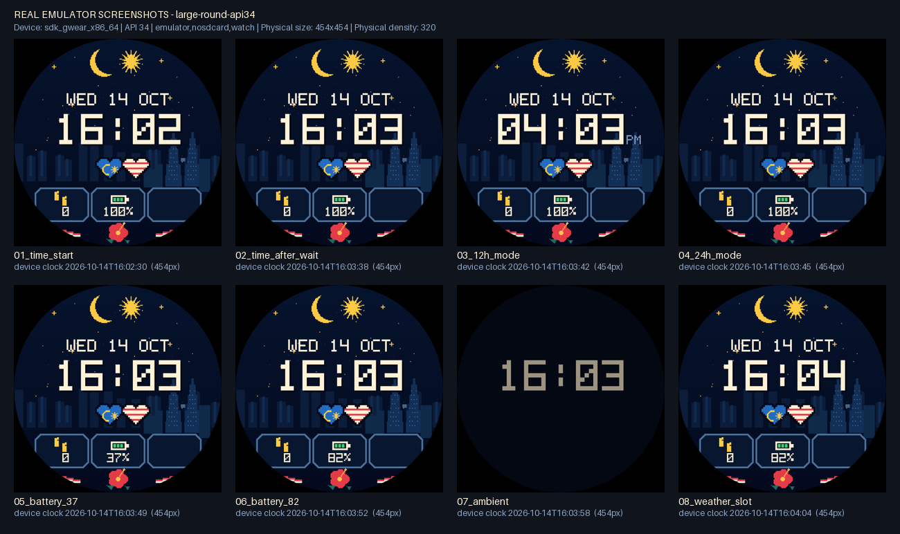
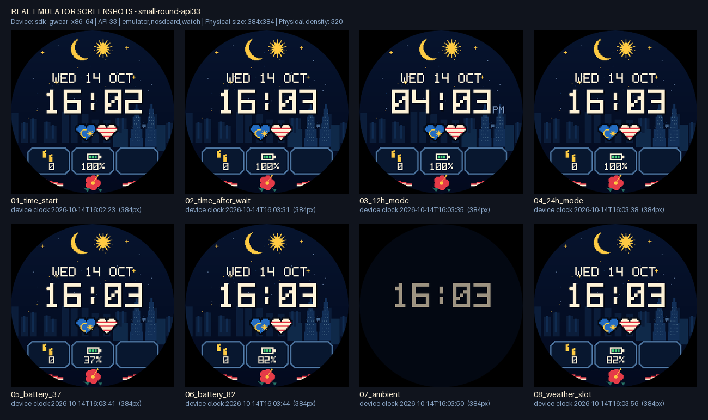

# Test report — Malaysia Pixel Lite (WFF v1)

Date: 2026-10-14. Emulator results are from CI run
[38593992222](https://github.com/darkstaarx/Pahlawan-angka/actions/runs/38593992222)
on commit `323bcef`.

## Where the tests ran

| Environment | What ran there |
|---|---|
| Development sandbox (Linux, no KVM; its network policy blocks `dl.google.com`, so no Android SDK or Google Maven) | Static checks, the official WFF validator, font rendering checks, a PowerShell 7 dry run of the Windows script with a stubbed `adb` |
| GitHub Actions `ubuntu-latest` (`.github/workflows/wearos-watchface.yml`) | APK build with AGP 9.0.0 / Gradle 9.2.1, then **real Wear OS emulators** with KVM: Wear OS 5 *Large Round* 454×454 (API 34) and Wear OS 4 *Small Round* 384×384 (API 33, the minimum for WFF v1). Both run `scripts/emulator-test.ps1`, the same script Windows users run. |

## Real emulator screenshots

Wear OS 5, 454×454 (API 34). Each tile is an unscaled `adb screencap`, with the device
clock at capture time:

Wear OS 4, 384×384 (API 33):

The individual PNGs, `summary.txt` and the runtime `logcat.txt` are in
`docs/emulator-run/<device>/`.

## Results

| # | Test | Result | Evidence |
|---|---|---|---|
| 1 | XML valid against the WFF schema | **Pass**, formats 1–5 | Google's validator (built from source): [`evidence/wff_validation.txt`](evidence/wff_validation.txt). It also passes in CI. |
| 2 | Static checks: resources, layer order, byte-identical layers, text inside the round screen, box heights | **Pass**, 98 checks | [`evidence/static_checks.json`](evidence/static_checks.json) |
| 3 | APK builds | **Pass** | CI `Build debug APK`. `aapt2 dump badging`: `com.malaysiapixel.lite`, minSdk 33, targetSdk 36, property `com.google.wear.watchface.format.version=1`, no code. The APK is a downloadable artifact on the run. |
| 4 | Installs; the system WFF runtime loads and renders it | **Pass** on both emulators | logcat: `Preparing WatchFaceDocument object for package: com.malaysiapixel.lite`, `DWF renderer 2.0.1`, `project 480.0 x 480.0, canvas 454 x 454` (and `384 x 384`). No parse errors. |
| 5 | Time is live and changes | **Pass** | `01_time_start`: 16:02 (device 16:02:30). `02_time_after_wait`: 16:03 (device 16:03:38). Same on both devices. |
| 6 | Date from the system | **Pass** | `WED 14 OCT` on 2026-10-14, which is a Wednesday. |
| 7 | 12-hour mode shows AM/PM | **Pass** | `03_12h_mode`: `04:03 PM` |
| 8 | 24-hour mode hides AM/PM | **Pass** | `04_24h_mode`: `16:03`, no AM/PM |
| 9 | Watch battery % | **Pass** | `05`: 37%, `06`: 82% (set with `dumpsys battery set level`); 100% otherwise |
| 10 | Steps | **Partly verified** | Shows `0`, the emulator's real step count. The runtime connected `HEALTH_STEP_COUNT`. A non-zero count needs a real watch (not tested). |
| 11 | Weather complication | **Empty state verified only** | The slot is `EMPTY` by default (logcat `Complication Type is changed id[0] : EMPTY`), and the frame stays empty: no icon, no invented value. **Not tested with a real weather provider**: none is installed on the emulator, and choosing one needs the on-watch editor. |
| 12 | Ambient / always-on | **Pass** | logcat `State changed visible [ true ] ambient [ true ]`. `07_ambient`: `12_aod_bg` and the dimmed time only, no animation. |
| 13 | Round safe zone | **Pass, with a design note** | All text ink stays inside the display circle (worst case r = 236.2 of 240 px, static check). In the emulator shots nothing is clipped at 454 or 384 px. The bottom data row sits outside the pack's r=204 "safe circle", because the pack's frames are there. |
| 14 | Small-screen readability | **Pass** (emulator) | 384 px: time, date, AM/PM, and 5-character data all legible (`small-round-api33/03_12h_mode.png`). |
| 15 | 450/480 scaling | **454 and 384 verified; 480 not run** | The runtime scales the 480 design by 0.9458 (454) and 0.8 (384). A 1:1 480×480 device was only checked statically. |
| 16 | Memory | **Estimate only** | Images: 1.41 MB interactive (11.06 MB if never cropped), 0.93 MB ambient, plus a 5 KB font. Limits are 100 MB / 10 MB. Google's memory-footprint tool was not run. |
| 17 | Layered background, not a flattened mockup | **Pass** | The APK contains the 13 layer PNGs as separate resources at their original byte sizes, plus the cropped weather icon. See [`evidence/layer_stack.png`](evidence/layer_stack.png) and the APK listing in the CI log. `reference_only/original_lite_mockup.png` is not packaged. |
| 18 | Runtime errors | **None caused by the face's behaviour** | `DWF:ResourceManager: Path is empty or null` appears exactly 5 times per document load. That matches the 5 user settings that have no optional `icon`: the likely cause, unconfirmed. The face renders normally. `ServiceConnectionLeaked` comes from the system runtime's own `RuntimeControlService`. |
| 19 | Windows test script | **Ran on Linux pwsh in CI**; dry-run on PowerShell 7.6 | Not yet run on a Windows PC or in Windows PowerShell 5.1. |

## Problems found while testing (fixed)

1. **CI only (run 1, cancelled).** `avdmanager` saved the AVD where the emulator did not
   look, so the emulator exited. An unbounded `adb wait-for-device` then hung.
   Fixed by switching to `reactivecircus/android-emulator-runner` with bounded timeouts.
2. **Charging screen (run 2).** Emulators report AC power, and Wear OS then draws a
   full-screen charging clock over any watch face. Our face was visible only in the
   battery shots, which simulated unplugging. The test script now simulates battery
   power for the whole run and resets it at the end. The README explains this.

## Not completed or not verified

- **No test on a physical watch** (for example, Galaxy Watch). Check the always-on view
  and readability on the real screen before publishing.
- **Weather with a real provider**: rendering of provider text and icon (including the
  "hide the pack icon when the provider sends one" rule) is untested.
- **Non-zero step counts** (needs a real watch or a simulated exercise).
- **480×480 at 1:1 scale** on an emulator or device.
- **Google's memory-footprint tool** (`play-validations`) was not run on the APK.
- **AOD pixel budget.** The default `12_aod_bg` background lights about 100% of pixels
  at a very low level (`#030915`). Wear OS guidance is at most 15% lit; with the
  "Navy always-on background" option off, about 5.5% are lit. Choosing the default
  before publishing is your call.
- **Face selection on the emulator** used the debug broadcast
  `com.google.android.wearable.app.DEBUG_SURFACE … set-watchface`. It worked on both
  images (`Favorite Id=[9] Runtime=[2]`), but it is not in the current official docs. On
  a real watch, choose the face by hand.
- Burn-in protection and low-bit ambient behaviour were not tested.
- Nothing was published, and no store accounts were created.

## How to reproduce

- Static checks: `python tools/check_watchface.py`
- XML validation: `bash tools/validate_wff.sh 1 2 3 4 5` (Git Bash or WSL)
- Emulator screenshots on Windows: start a Wear OS emulator, then run
  `powershell -ExecutionPolicy Bypass -File scripts\emulator-test.ps1`
- CI: push changes under `wearos/malaysia-pixel-lite/`, or run the workflow manually.
